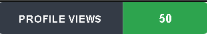
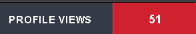
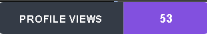
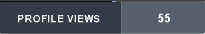
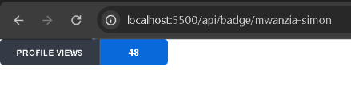

# GitHub Badge Generator

A customizable GitHub profile badge generator built with **Node.js, Express, and MongoDB**. It generates dynamic SVG badges that track profile views and display the counter directly in your GitHub README.

Users can customize their badges using URL query parameters, including the label, counter color, and badge style.

## Features

- Dynamic SVG badge generation.
- Automatic profile view tracking.
- MongoDB persistence for profile view counts.
- Customizable badge labels.
- Multiple counter colors.
- Multiple badge styles.
- SVG responses that can be embedded directly into GitHub README files.
- Atomic view increments using MongoDB's `$inc` operator.

## Tech Stack

- Node.js
- Express.js
- MongoDB
- Mongoose
- SVG

## Project Structure

```text
src/
├── config/
│   └── db.js
├── controllers/
│   ├── badgeController.js
│   └── profileViewController.js
├── models/
│   └── profileViews.js
├── routes/
│   ├── badgeRouter.js
│   └── statsRouter.js
├── services/
│   └── badgeService.js
└── server.js
```

## Getting Started

### 1. Clone the repository

```bash
git clone YOUR_REPOSITORY_URL
cd github-dynamic-badge-generator
```

### 2. Install dependencies

```bash
npm install
```

### 3. Configure environment variables

Create a `.env` file in the project root:

```env
PORT=5500
MONGO_URI=your_mongodb_connection_string
```

### 4. Start the development server

```bash
npm run dev
```

The API will be available at:

```text
http://localhost:5500
```

## API Usage

### Generate a badge

**Endpoint:**

```http
GET /api/badge/:username
```

Example:

```text
http://localhost:5500/api/badge/mwanzia-simon
```

The endpoint:
1. Receives the GitHub username.
2. Finds or creates the user's profile view record.
3. Increments the view counter.
4. Generates an SVG badge.
5. Returns the SVG image.

Each request to the badge endpoint increments the counter.

### Customization Parameters

The badge supports the following query parameters:

| Parameter | Description | Default |
|---|---|---|
| `label` | Text displayed on the left side of the badge | PROFILE VIEWS |
| `color` | Counter background color | blue |
| `style` | Badge background style | gradient |

### Available Colors

The following colors are currently supported:

| Color | Example URL | Screenshot |
|---|---|---|
| Blue | `?color=blue` |  |
| Green | `?color=green` |  |
| Red | `?color=red` |  |
| Orange | `?color=orange` |  |
| Purple | `?color=purple` |  |
| Gray | `?color=gray` |  |

*The image paths above are placeholders. Add your actual badge screenshots to the corresponding files.*

### Available Styles

| Style | Description |
|---|---|
| `gradient` | Uses the gradient background style |
| `flat` | Uses a solid counter background color |

Examples:

**Gradient badge**

```text
/api/badge/mwanzia-simon?color=blue&style=gradient
```

**Flat badge**

```text
/api/badge/mwanzia-simon?color=green&style=flat
```

### Custom Labels

You can change the text displayed on the left side:

```text
/api/badge/mwanzia-simon?label=VISITORS&color=green
```

Another example:

```text
/api/badge/mwanzia-simon?label=PROFILE%20VIEWS&color=purple
```

## Embedding the Badge in GitHub README

You can display your generated badge in any GitHub README using Markdown:

```markdown

```

You can also use HTML:

```html

```

Replace `YOUR_DEPLOYED_DOMAIN` with your deployed API URL and `YOUR_GITHUB_USERNAME` with your GitHub username.

## Profile Statistics Endpoint

The project also provides a JSON endpoint for retrieving profile statistics.

```http
GET /api/stats/:username
```

Example:

```text
/api/stats/mwanzia-simon
```

This endpoint increments the counter and returns the updated statistics as JSON.

## Screenshots

### Badge Examples

Add screenshots of your generated badges here.

| Badge | Preview |
|---|---|
| Blue | `docs/images/blue-badge.png` |
| Green | `docs/images/green-badge.png` |
| Red | `docs/images/red-badge.png` |
| Orange | `docs/images/orange-badge.png` |
| Purple | `docs/images/purple-badge.png` |
| Gray | `docs/images/gray-badge.png` |

### API Response

Add a screenshot of the generated SVG displayed in your browser.



## Future Improvements

- Independent customization of label and counter backgrounds.
- Additional badge themes and styles.
- More advanced SVG designs.
- Badge caching and performance optimization.
- Public deployment.
- Additional statistics and analytics.

## Author

**Simon Makau**

GitHub: [mwanzia-simon](https://github.com/mwanzia-simon)

---

*Built as a learning project to explore backend development, REST APIs, MongoDB, and dynamic SVG generation.*